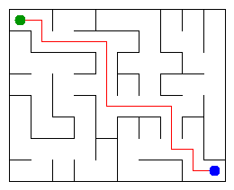

# Assignment 3. Maze Escape

Student ID: 250349
Name: Aruzhan Kazhumuratova
Group: SE-2511
Maze size (rows x columns): 8 x 10

This file is the report. Fill it in as you go. How to start: `START_HERE.md`. The task: `docs/Assignment3.pdf`.

## Program output

The 13 lines your program prints on your data (`java -cp out Main`):

    Broken: 79
    Kept: 63 
    Last broken wall: 113
    MST cost: 23683
    Heaviest broken wall: 755
    Path length: 16
    DFS visited: 45
    Dead ends: 26
    Zones: 9
    Largest zone: 16
    Is DAG: 0
    Flow stages: 6
    Fastest route cost: 11

My maze:

## Questions

Answer in your own words, two or three sentences each.

Mission 0. What do find and union do, and what makes them fast in your code?
The find method finds the root of a set, while union merges two different sets. I used path compression and union by size to make these operations faster.

Mission 1. Why is Broken always R*C - 1, and Kept always (R-1)*(C-1)?
The maze has RC cells, and a spanning tree needs exactly RC - 1 edges to connect all cells without cycles. The remaining walls are (R-1)(C-1), because a grid has R(C-1) + C*(R-1) inner walls.

Mission 2. My MST cost from Kruskal and from Prim, and why they are equal:
The MST cost from both Kruskal and Prim is 23683. Both algorithms find a minimum spanning tree, so their total costs must be equal even if their methods of selecting edges are different.

Mission 3. Why is there exactly one path between two cells? How did you avoid a stack overflow on a huge maze?
The maze is a tree, so there is exactly one simple path between any two cells. I used iterative DFS with arrays as a stack instead of recursive DFS to avoid stack overflow.

Mission 4. Why does the second pass of Kosaraju go on the reversed graph? Why do the slides have no cycle exactly when Zones equals the number of cells?
The reversed graph helps the second DFS identify each strongly connected component without mixing different components. If every cell is its own SCC, the directed graph has no cycles, so the number of zones equals the number of cells.

Mission 5. Why is it enough to go through the zones in the order of their numbers? What does this pass cost?
The zones are numbered in topological order, so every transition goes from a smaller zone number to a larger one. This allows us to calculate the longest chain and shortest route in one pass, taking O(Z + S) time, where Z is the number of zones and S is the number of slides.

## AI use
I used ChatGPT to help understand the assignment requirements, discuss algorithm implementations, and identify compilation errors.

The syllabus requires you to say which AI tools you used and for what. Write the tool (ChatGPT, Copilot, other) and what you asked it: explain an idea, find an error, review code. Write "none" if you did not use any. If you took code or text from a book or a website, give the source here.

## Timing (Mission 7)

Milliseconds, 5 runs each, from `java -cp out Bench`.

| maze | Kruskal | Prim |
|---|---------|------|
| 100 x 100 | 8       | 7    |
| 300 x 300 | 46      | 46   |
| 1000 x 1000 | 668     | 1183 |

What do the numbers say about how the time grows? Two or three sentences.
The execution time of both algorithms increased as the maze size grew. On the 100 × 100 maze, Prim was slightly faster, while both algorithms had the same average time on the 300 × 300 maze. On the 1000 × 1000 maze, Kruskal was faster than Prim in my measurements.

## Complexity

n is the number of cells, m the number of walls (or slides). Fill in every algorithm you wrote.

| algorithm | time     | space | assumptions |
|---|----------|------|---|
| DSU find and union | O(a(n)) amortized | O(n) | Path compression and union by size|
| Kruskal | O(m log m) | O(n + m) | Sorting edges and using DSU|
| Prim | O(m log m) | O(n + m) | Adjacency lists and priority queue|
| DFS | O(n + m) | O(n + m) | Iterative DFS with stack|
| Kosaraju | O(n + m) | O(n + m) | Two DFS passes|
| Route in the zone graph | O(Z + m) | O(Z + m) | DAG in topological order|

## Before you submit

- data/walls.txt, data/slides.txt and output/maze.png are in the repository.
- `java tools/Check.java` shows all examples right.
- This README is filled in, the program output and the section AI use included.
- The work is pushed to main (at least one commit per mission) and the repository is public.
- The link is attached in Moodle.
